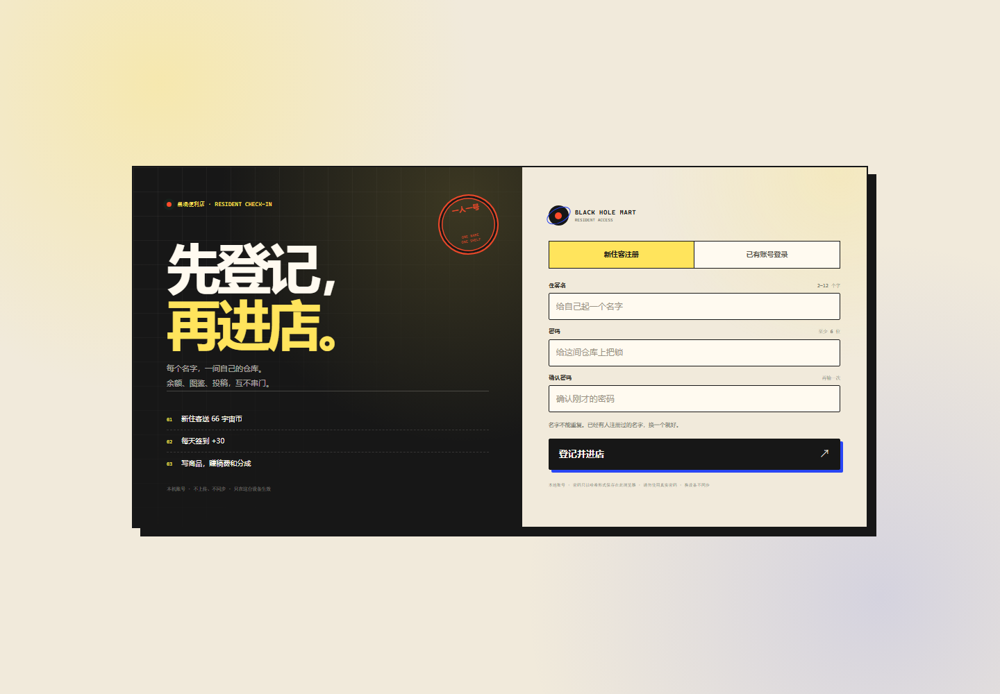
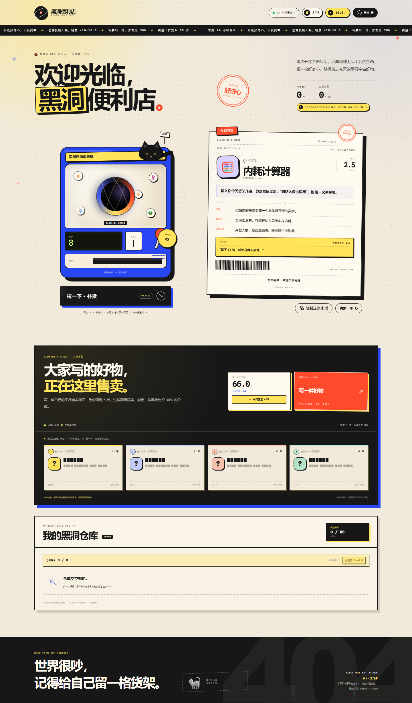

# 黑洞便利店 · Black Hole Mart

一家开在宇宙尽头的便利店，24 小时营业，只收好奇心。

现在每个住客都要先登记一个名字、设一把锁，再进自己的仓库。官方图鉴已经扩到 **88 件**；仓库默认 **8 格**，可以用宇宙币扩到 **16 格**——抽到的住客投稿也会一起收进去。





**在线玩：** <https://xq1125.github.io/blackhole-mart/>

## 账号规则

- 第一次来，点 **「新住客注册」**，起一个 2–12 个字的名字，设置至少 6 位的密码。
- 名字在同一台设备上不能重复；登录时不区分英文大小写。
- **`夏习清` 这个名字已经有人注册，不能再注册。**
- 这个账号的初始密码通过私下渠道提供，**不写在公开仓库里**。第一次登录后，点右上角的住客头像 → **「换一把锁」** 修改密码。
- 右上角头像可以打开账号面板：查看身份、修改密码、退出登录。
- 账号、密码哈希、余额和仓库都保存在 **当前浏览器**，不会上传到服务器；换设备不同步。
- 这是本地账号，不是银行级安全系统。**不要使用你在其他网站的真实密码。**

## 为什么是“本地账号”

GitHub Pages 是纯静态托管，没有后端。当前版本用 localStorage 实现了：

- 每个账号独立的余额、图鉴、签到、投稿和仓库；
- 密码用 PBKDF2-SHA256（每账号独立盐，120,000 次迭代）哈希后保存，不存明文；
- `夏习清` 这个名字在代码里保留，任何浏览器都不能注册；
- 其他名字的“全局唯一”只能在真正有后端的版本里保证。当前只在同一台设备内唯一。

如果要做跨设备、全网友共用的账号系统，需要接 Supabase / Firebase 之类的后端。页面上的「本机账号」标注的就是这个边界。

## 怎么玩

- **拉摇杆 / 按「拉一下」/ 按空格**，随机抽取一件好物。
- 机器一轮库存 **8 件**，拉一次少一件；库存到 `0` 后按钮才会变成「补货 8 件」，花 **8.8 币**补货后可以再拉 8 次。
- 第二天会自动补满 8 件；同一天想继续拉，就花钱补货。
- 一轮 **8 抽免费**，不按次扣币；库存拉完后花 **8.8 币**补货，相当于一次付费买 8 抽。
- 每天有一次「店长请客」：库存为 0 且余额不足时，可以免费补货一次；当天用完后需要签到/投稿赚币。
- 抽到的新品会先出一张 **小票**；点「**复制小票并入仓**」后才会进入 **「我的黑洞仓库」**，不会抽一件就直接塞一件。
- 待入库的小票不复制就直接拉下一件，旧小票会自动作废。
- 待入库的小票刷新页面也会保留；重复款仍然自动寄售。
- 待入库时也可以先打开仓库或共创货架，点开完整便签对比，再决定要不要复制；小票不会因此丢掉。复制前按钮是黄的，复制成功后变成透明底。
- 仓库默认容量 **8 格**，超过就要先移除一件。
- 点仓库里的任意好物，会打开放大的**完整便签**：名称、价格、描述、功效、副作用、适用人群、买家评价和条码都能看；可以复制小票或直接收好。
- 仓库满了以后拉杆会提示，不会扣币；点收藏卡右上角的 `×` 可以移除单件。
- 老账号如果之前已经存了超过 8 件，不会自动清空；会显示「超出」，可以先移除或扩容。
- 可以用宇宙币扩容，每次 **+2 格**：`8 → 10` 88 币、`10 → 12` 188 币、`12 → 14` 288 币、`14 → 16` 388 币；**最高 16 格**。
- **图鉴**是独立于仓库的 88 格拼图（85 件常规 + 3 件隐藏款）：好物入仓时点亮对应格子，之后从仓库删除或清空也不会熄灯。
- 图鉴格子只显示**名字**，不显示价格、功效或副作用；想反复看详情，回仓库点开对应的小票。
- 图鉴下面还有 **玩家寄售**：展示最近 8 件住客寄售，抽中并收进仓库后点亮对应瓶子；没有寄售时是一排灰瓶。
- 玩家寄售和官方图鉴一样，删除/清空仓库不会熄灯，也只显示名字，不显示具体内容。
- 仓库容量（8–16 格）和图鉴进度（0–88）是两套独立数据。
- 「今日到货」由日期决定，每天打开会换一件。

## 怎么赚宇宙币

- **每日签到**：共创货架里的「今日签到 +30」，每天一次。
- **写一件好物**：售价固定为 **3.3 / 6.6 / 9.9 / 12.9 / 19.9** 五档，不再自由填 0–99。上架稿费跟着物价递增：

  | 售价 | 3.3 | 6.6 | 9.9 | 12.9 | 19.9 |
  | --- | --- | --- | --- | --- | --- |
  | 稿费 | 10.0 | 11.6 | 13.3 | 14.9 | 16.6 |

  签到每天 +30。
- **拿销售分成**：商品上架后会立刻卖出第 1 件，作者拿售价的 30%；之后每次有顾客买走，也会继续分成。
- **重复款寄售**：抽到已经拥有的好物时，会自动寄售，换回售价的 50%。
- 抽签、重复款、销售和签到都会实时更新右上角的宇宙币余额。

## 共创货架

- 写商品时可以填：名称、售价、图标、卖点、分类、副作用、署名。
- 投稿通过后立刻上架，并获得稿费和首位顾客分成。
- 自己的作品会出现在「共创货架」最前面，标着 **我的作品**；卡片上会显示已售数量和每件分成。
- 官方 88 件之外，还有 **66 张匿名住客便签**，收在共创区的「住客便签墙」里；它们会进入抽签池，抽中并复制小票入仓后，会在「玩家寄售」点亮，不占 88 格官方图鉴。
- 新账号的共创货架是空的（0 件）；空货架会摆 **4 件打码样品**，它们不计入投稿数、不参与售卖。写第一件好物后，真实卡片会替换掉样品。
- 新投稿的售价固定为 5 档（3.3 / 6.6 / 9.9 / 12.9 / 19.9），避免货架价格忽高忽低；首笔销量只有 1 件，不会凭空送 10 件。
- 每个账号的投稿和余额是独立的，切换账号会看到不同的仓库。

## 运行与数据

零依赖、零构建，纯静态页面。GitHub Pages 版本直接打开链接即可；本地开发建议用服务器：

```powershell
cd blackhole-mart
python -m http.server 8000
```

然后访问 <http://localhost:8000>。

> 部分浏览器在 `file://` 下会禁用 Web Crypto，导致本地账号无法哈希密码；用 `localhost` 或 HTTPS 打开即可。剪贴板权限也是同样的情况。

### localStorage 结构

| key | 内容 |
| --- | --- |
| `blackhole-mart.accounts.v1` | 账号名、盐、密码哈希、角色、注册时间 |
| `blackhole-mart.session.v1` | 当前登录的账号 id |
| `blackhole-mart.game.v2.<账号id>` | 该账号的余额、仓库容量、图鉴、签到、投稿、仓库 |
| `blackhole-mart.v1` | 旧版匿名存档；`夏习清` 账号第一次登录时会自动并入，然后删除 |

> 旧版匿名存档只会并入 **夏习清** 账号，避免旧进度落到陌生账号里。

## 文件

| 文件 | 说明 |
| --- | --- |
| `index.html` | 页面结构、住客登记处、账号面板、共创货架与投稿弹窗 |
| `styles.css` | 视觉、响应式布局与所有 CSS 动画 |
| `app.js` | 88 件商品、账号认证、经济系统、抽取、仓库、投稿与音效 |
| `preview-auth.png` | 住客登记处预览 |
| `preview.png` | 登录后的全页预览 |

## 一些实现细节

- 纯 HTML / CSS / JS，无图片资源，无第三方字体和依赖，离线可用。
- 售货机、黑洞、猫店长、贴纸和印章都是 CSS 画的；商品图标使用系统 emoji。
- 密码通过 Web Crypto 的 PBKDF2-SHA256 派生；每个账号独立随机盐，localStorage 里没有明文密码。
- 小票的条形码由商品 id 和日期生成，带一点确定性随机。
- 音效用 Web Audio API 实时合成，不加载音频文件。
- 响应式覆盖到 320px 宽；手机端的共创货架是横向滑动的卡片流。
- 支持键盘操作、`prefers-reduced-motion`，住客登记、账号、复制和投稿窗口都使用适合弹窗的焦点管理。

## 想改点什么

- 官方商品库：编辑 `app.js` 顶部的 `PRODUCTS` 和 `RARE_PRODUCTS`。
- 初始住客投稿：编辑 `COMMUNITY_SEEDS`。
- 预置账号、保留名：搜索 `AUTHOR_SEED`、`RESERVED_NAME_KEYS`。
- 补货价格、签到奖励、分成比例：搜索 `RESTOCK_COST`、`CHECKIN_BONUS`、`ROYALTY_RATE`、`DUPLICATE_RATE`。
- 隐藏款概率：搜索 `RARE_CHANCE`。
- 主色、纸张色、字体：编辑 `styles.css` 顶部的 CSS 变量。

---

店长今天在收银台睡觉。自助结账，谢谢。
